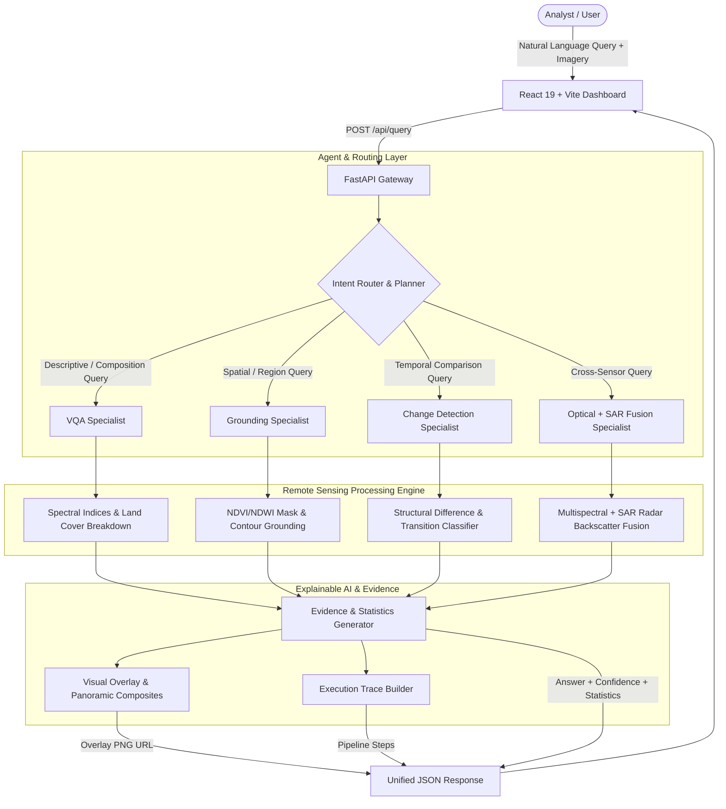

# SatQuery AI — Conversational Satellite Intelligence

> **Smart India Hackathon 2026 / ISRO Space Applications Centre (SAC)**  
> **Problem Statement ID:** 26167  
> **Repository Milestone:** Complete Working Prototype & Demonstration Platform

---

## 1. Vision & Architecture

**SatQuery AI** is an explainable vision-language system that allows users to upload satellite imagery and query it using natural language. Instead of forcing manual GIS and remote sensing workflows, SatQuery understands the analyst's intent and automatically routes the request to the appropriate specialist module:

1. **Remote-Sensing Visual Question Answering (VQA)**
2. **Visual Grounding & Referring Expression Localization**
3. **Bi-Temporal Change Detection**
4. **Optical + SAR Multi-Modal Fusion**



---

## 2. Integrated SIH 26167 Benchmark Datasets

The platform includes pre-configured demo datasets and annotations aligned with the official benchmarks specified for PS 26167:

| Benchmark Dataset | Sensor / Modality | Role in SatQuery |
|-------------------|-------------------|------------------|
| **BigEarthNet.txt** | Sentinel-1 SAR + Sentinel-2 Multispectral | Primary fine-tuning benchmark, S1/S2 co-registered pairs, multimodal land-cover instruction data. |
| **VRSBench** | High-Resolution Aerial / Satellite Orthophoto | Captioning, referring expression grounding, and object localization. |
| **RSVQA (RSVQA-LR)** | Sentinel-2 (256x256 / 512x512) | Single-image remote sensing visual question answering and dominant cover reasoning. |
| **CDVQA** | Bi-Temporal Remote Sensing Pairs (T1 & T2) | Temporal change detection and change-based visual question answering. |
| **ISRO Cartosat + RISAT** | Cartosat-2S (Optical) + RISAT-1 (C-Band SAR) | Cross-modal sensor fusion simulating the ISRO-SAC evaluation dataset. |

---

## 3. Quick Start & Setup

### Prerequisites
- Python 3.10+
- Node.js 18+ and npm

### Backend Setup

```bash
cd SatQuery/backend
pip install -r requirements.txt
python -m uvicorn app.main:app --host 127.0.0.1 --port 8000 --reload
```

- **API Base:** `http://127.0.0.1:8000`
- **Swagger Documentation:** `http://127.0.0.1:8000/docs`
- **Health Check:** `http://127.0.0.1:8000/api/health`

### Frontend Setup

```bash
cd SatQuery/frontend
npm install
npm run dev
```

- **Dashboard:** `http://127.0.0.1:5173`

---

## 4. Demonstrating the 4 Core Capabilities to Judges

You can run each demonstration in under 30 seconds using the pre-loaded 1-click presets in the sidebar:

### Demo 1 — Remote Sensing VQA
1. Select **"Agricultural Land & Water (VQA)"** in the left sidebar.
2. The image and prompt (`"What is the dominant land cover in this image?"`) populate automatically.
3. Click **"Run Query"**.
4. **Result:** The system classifies intent as `VQA`, reports `Vegetation / Forest (51.07%)` as the dominant class, details water (12.11%) and urban percentages, and displays an explainable execution trace.

### Demo 2 — Visual Grounding & Region Localization
1. Select **"Water Reservoir Grounding"** or **"Coastal Harbor & Docks"**.
2. Query: `"Show me the water bodies."` or `"Where are the built-up structures and docks?"`.
3. Click **"Run Query"**.
4. **Result:** The system routes to `GROUNDING`, highlights regions with an emerald/cyan translucent overlay, draws glowing contour bounds and HUD bounding boxes with area percentages, and identifies the spatial quadrant (`central region`).

### Demo 3 — Bi-Temporal Change Detection
1. Select **"Urban Expansion & Industrial Development"**.
2. Loads Image T1 (Baseline) and Image T2 (Post-development).
3. Query: `"What changed between these two images?"`.
4. Click **"Run Query"**.
5. **Result:** Intent is classified as `CHANGE_DETECTION`. The engine computes a pixel difference tensor, identifies `+7.3%` newly developed industrial structures and `-6.5%` vegetation clearance, and generates a **3-panel panoramic composite** (`BEFORE` | `AFTER` | `CHANGE MAP`).

### Demo 4 — Optical + SAR Multi-Modal Fusion
1. Select **"Optical (Cartosat-2S) + SAR (RISAT-1) Fusion"**.
2. Loads optical multispectral tile + C-band SAR radar backscatter tile.
3. Query: `"Combine optical and SAR imagery to identify built-up areas."`.
4. Click **"Run Query"**.
5. **Result:** Intent is classified as `FUSION`. The engine cross-correlates optical spectral reflectance with SAR radar double-bounce backscatter to confirm `2.07%` high-density built-up infrastructure, while disambiguating water from asphalt shadows.

---

## 5. Verification Test Suite

To run the automated backend test suite covering all endpoints and specialists:

```bash
cd SatQuery
python backend/test_backend.py
python verify_e2e_scenarios.py
```

Both tests verify `/api/health`, `/api/samples`, VQA, Grounding, Change Detection, and Multi-Sensor Fusion.
